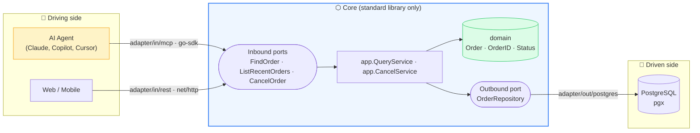

# orders-mcp-go ⬡🐹

> **The same hexagonal MCP server as [orders-mcp](https://github.com/cbuelvasc/orders-mcp), now in Go.** Same tools, same scopes, same metrics and the same dashboard, so the two can be compared fairly.


| What | Choice |
|---|---|
| Language | Go 1.25 |
| MCP | Official Go SDK (`modelcontextprotocol/go-sdk`) · Streamable HTTP on `/mcp` |
| Security | OAuth 2.1 bearer tokens (JWT RS256 + JWKS) · scopes per tool · RFC 9728 metadata |
| Persistence | PostgreSQL · `pgx` · embedded SQL migrations (same SQL as the Java version) |
| Tests | Unit · shared contract test (in-memory + PostgreSQL via Testcontainers) · architecture test |
| Observability | Prometheus (`mcp_tool_duration_seconds`, `mcp_tool_errors_total`) · Grafana |
| Load testing | k6 (same script as the Java version) |

---

## 🧩 Architecture



## 🔁 Java ↔ Go, side by side

| Concept | Java (`orders-mcp`) | Go (`orders-mcp-go`) |
|---|---|---|
| Tool declaration | `@McpTool` on a method | `mcp.AddTool(server, &mcp.Tool{...}, handler)` |
| Tool input schema | `@McpToolParam` | struct tags `json` + `jsonschema` |
| Scope per tool | `@PreAuthorize("hasAuthority('SCOPE_orders:read')")` | `require(scopes, ScopeRead)` with `req.Extra.TokenInfo` |
| Bearer token on `/mcp` | Spring Security resource server | `auth.RequireBearerToken` (SDK) + our JWKS verifier |
| Inbound ports | Java interfaces | Go interfaces in `internal/domain/ports.go` |
| Persistence | `JdbcClient` + Flyway | `pgx` + embedded migrations |
| Contract test | abstract JUnit class | `contract.RunOrderRepositoryContract(t, ...)` |
| Architecture rules | ArchUnit | `internal/archtest` (parses imports with `go/parser`) |
| Metrics | Micrometer | `prometheus/client_golang`, **same metric names** |

## 📁 Structure

```text
cmd/server/                    wiring (the only place that knows every piece)
internal/
├── domain/                    ← standard library only
│   ├── ids.go                 OrderID, CustomerID (value objects)
│   ├── order.go               Order aggregate, Cancel rule
│   ├── errors.go              ErrOrderNotFound, ErrCannotBeCancelled, ErrInvalidInput
│   └── ports.go               inbound + outbound ports
├── app/                       QueryService, CancelService
├── adapter/
│   ├── in/mcp/                tools.go (logic) + server.go (SDK binding)   ← AI entry door
│   ├── in/rest/               net/http handlers                            ← human entry door
│   ├── out/postgres/          pgx repository + embedded migrations
│   └── out/memory/            in-memory test double
├── contract/                  shared tests every OrderRepository must pass
├── platform/
│   ├── auth/                  JWT (RS256/JWKS) verifier, middleware, RFC 9728 metadata
│   └── observability/         Prometheus metrics
└── archtest/                  architecture rules
```

## 🚀 Run it

Requirements: **Go 1.25+** and **Docker**.

```bash
go mod tidy        # first time only: resolves versions and creates go.sum
make up            # Postgres, Keycloak, Prometheus, Grafana
make run           # MCP server on :8080
```

| Service | URL |
|---|---|
| MCP server | http://localhost:8080/mcp |
| Keycloak (realm `orders`) | http://localhost:8180 |
| Prometheus | http://localhost:9090 |
| Grafana | http://localhost:3000 → **MCP › Orders MCP (Go) · Tools** |

```bash
TOKEN=$(./scripts/get-token.sh orders-readonly orders:read)
curl -i http://localhost:8080/api/orders/ORD-1042 -H "Authorization: Bearer $TOKEN"

curl -i -X POST http://localhost:8080/mcp
# 401 + WWW-Authenticate: Bearer resource_metadata="http://localhost:8080/.well-known/oauth-protected-resource/mcp"
```

> Client secrets and passwords in `compose.yaml` and the realm file are **local demo values**.

## 🧪 Tests

```bash
make test          # unit + in-memory contract + architecture (no Docker needed)
make integration   # contract tests against real PostgreSQL with Testcontainers
```

Architecture rules (`internal/archtest`):

- the domain only uses the standard library,
- `app` only imports the domain,
- only the MCP adapter (and `main`) import the MCP SDK,
- only the PostgreSQL adapter (and `main`) import `pgx`,
- inbound adapters depend on ports, never on `app`.

## 🔐 A note on JWT validation

`internal/platform/auth` validates RS256 tokens with the standard library (JWKS fetch with key rotation, `alg` pinning, `iss`, `exp`, `nbf`, `scope`/`scp`). It is small on purpose, to make every check visible. For production you can swap it for a vetted JOSE library behind the same `Verify` function.

## ⚡ Load test

```bash
k6 run k6/mcp-load-test.js
```

Same script and thresholds as the Java version: real `client_credentials` token, ramp to 200 tool calls/second.

## 🛣️ Series

Part of **[MCP in Production: Java & Go](https://cbuelvasc.hashnode.dev/series/mcp-in-production)**.

- [x] Parts 1–4: Java (`orders-mcp`)
- [x] Part 5: this repo, the Go version
- [ ] Part 6: Java vs Go benchmarks

## 👤 Author

**Carmelo Buelvas** · Senior Backend Engineer · Java, Go & AI (MCP)

[](https://www.linkedin.com/in/cbuelvasc/)
[](https://cbuelvasc.hashnode.dev)
[](https://github.com/cbuelvasc)
